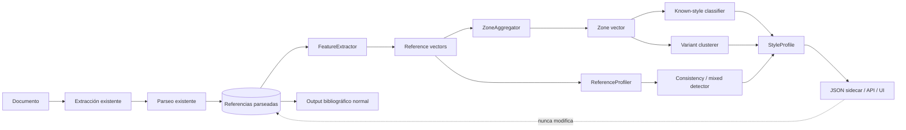
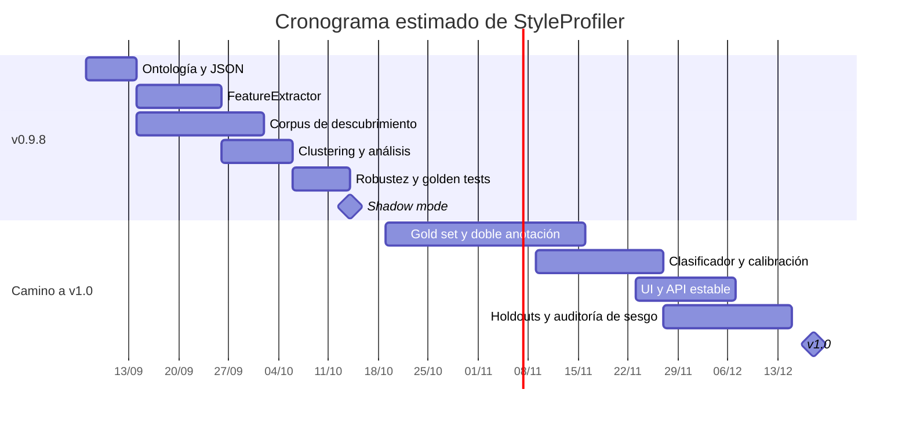

# Diseño e integración de StyleProfiler para BiblioRef v0.9.8

## Resumen ejecutivo

La incorporación de un módulo **`StyleProfiler`** a BiblioRef v0.9.8 es técnicamente viable y, dado que el parseo bibliográfico ya está implementado, conviene diseñarla como una **capa analítica posterior e independiente de la extracción**. La regla arquitectónica central debería ser:

> **StyleProfiler observa lo extraído; nunca decide qué se extrae, nunca corrige referencias y nunca retroalimenta al parser en v0.9.8.**

Esta separación permite desplegar el módulo inicialmente en **shadow mode**, medir su comportamiento sobre documentos reales y retirar o recalibrar el profiler sin afectar el pipeline principal.

La investigación sobre normas y ecosistemas bibliográficos muestra que no conviene tratar “APA”, “ABNT”, “Vancouver” e “IEEE” como cuatro clases perfectamente equivalentes. APA se define explícitamente como un sistema autor-fecha; IEEE se categoriza como numérico; las recomendaciones ICMJE remiten actualmente al estilo NLM; y ABNT NBR 10520 admite tanto sistemas de llamada autor-data como numéricos. Es decir, **sistema estructural y estilo probable son dimensiones parcialmente ortogonales**. citeturn18search2turn18search3turn15search0turn18search0turn17search15

Por ello se recomienda que el modelo interno distinga:

```text
family
    author_year
    numeric
    mixed
    unknown

likely_style
    apa_like
    abnt_like
    vancouver_like
    ieee_like
    mixed
    unknown

variant
    cluster o variante local inferida
```

De este modo, una bibliografía puede ser, por ejemplo:

```text
family       = author_year
likely_style = abnt_like
variant      = local_cluster_07
```

sin forzar la falsa equivalencia `author_year = APA`.

La existencia de estilos “padre”, estilos dependientes y archivos de localización en Citation Style Language refuerza esta decisión: CSL separa explícitamente estilos independientes, estilos dependientes y *locale files*, y estos últimos contienen traducciones, formatos de fecha y reglas gramaticales. Además, el repositorio CSL contiene variantes como APA 7 en euskera que parten de la plantilla APA. Esto ofrece un correlato técnico muy claro para distinguir **familia → estilo probable → variante/localización**. citeturn15search2turn15search11turn18search23

La estrategia recomendada es híbrida. En v0.9.8, **rasgos estructurales explicables + clustering no supervisado** deberían utilizarse para descubrir familias y variantes; HDBSCAN aparece como mejor candidato principal para descubrir variantes y *outliers*, acompañado por clustering aglomerativo para analizar jerarquías y por k-means como *baseline*. DBSCAN resulta útil como prueba de sensibilidad, pero es menos apropiado como algoritmo principal cuando las densidades de los grupos difieren. La documentación actual de scikit-learn señala precisamente que HDBSCAN extiende la lógica de DBSCAN explorando múltiples escalas de densidad y permite tratar como ruido observaciones que no pertenecen claramente a ningún grupo. citeturn15search3turn15search9

Para una v1.0, una vez creado un corpus manualmente etiquetado, convendría pasar a un esquema híbrido **supervisado + descubrimiento no supervisado**: un clasificador calibrado asignaría `likely_style` a estilos conocidos, mientras HDBSCAN seguiría detectando variantes locales, combinaciones no conocidas y cambios históricos.

La unidad de decisión debería existir en **dos niveles simultáneos**:

```text
referencia → clasificación local + anomalía + evidencia

zona bibliográfica → estilo dominante + consistencia
                     + mezcla + distribución + variante
```

Esto permitiría responder preguntas distintas. La referencia individual indica “¿esta entrada se parece al patrón predominante?”. La zona responde “¿qué estilo domina y hasta qué punto es internamente consistente?”.

Para el corpus se recomienda combinar repositorios de tesis y publicaciones académicas con perfiles disciplinares y geográficos distintos. TDR es la denominación española del repositorio TDX; TDX ofrece metadatos Dublin Core mediante OAI-PMH. Dialnet dispone de un portal específico de tesis y acceso a texto completo cuando este se encuentra disponible. SciELO Argentina ofrece revistas científicas a texto completo en acceso abierto. Para PubMed, la vía adecuada para obtener textos reutilizables es fundamentalmente PMC/Open Access mediante sus interfaces autorizadas, mientras arXiv recomienda OAI-PMH para la cosecha masiva de metadatos y dispone de mecanismos específicos para acceso programático. citeturn20search20turn16search0turn17search0turn17search20turn16search1turn16search2turn16search6turn16search3

Como primera escala de trabajo, propongo un **corpus de descubrimiento de alrededor de 5.000 documentos** y un **gold set de aproximadamente 1.500 zonas bibliográficas / 30.000–50.000 referencias**, con particiones realizadas por documento y repositorio, nunca repartiendo referencias del mismo documento entre entrenamiento y test. Esta cifra es una recomendación de ingeniería, no una exigencia estadística universal.

La salida pública debería decir **“APA-like”**, no “APA”, y mucho menos “cumple APA”. StyleProfiler estará estimando semejanza morfológica; la conformidad normativa estricta exige información que puede haberse perdido en PDF o durante el parseo —itálicas, capitalización exacta, tratamiento dependiente del tipo documental, etc.— y normas como APA o NLM contienen reglas condicionales según la fuente citada. APA, por ejemplo, conceptualiza las referencias mediante autor, fecha, título y fuente, pero las reglas concretas varían según el tipo documental. citeturn18search22turn18search26turn18search29

La recomendación global es, por tanto:

```text
v0.9.8
StyleProfiler = observador estructural explicable
              + clustering
              + shadow mode
              + UNKNOWN como resultado legítimo

v1.0
StyleProfiler = clasificador calibrado
              + detector de variantes
              + detector de mezcla/anomalías
              + versionado temporal de estilos
```

## Marco conceptual y taxonomía del estilo

El problema no debe formularse como “identificar qué manual usó el autor”, porque esa variable puede ser intrínsecamente inobservable. Dos estilos distintos pueden generar referencias superficialmente muy parecidas y una universidad puede modificar una norma general mediante instrucciones institucionales. El propio ecosistema CSL refleja esta situación: existen estilos independientes, estilos dependientes que reutilizan un estilo padre y localizaciones que alteran terminología, fechas y gramática sin constituir necesariamente una nueva familia bibliográfica. citeturn15search2turn15search5turn15search11

Además, las principales familias inicialmente propuestas no se separan todas mediante la misma dimensión. APA emplea un sistema autor-fecha; IEEE aparece clasificado en CSL como numérico y orientado a ingeniería; NLM contempla sistemas de secuencia, nombre-secuencia y nombre-año; ABNT distingue la norma para elaborar referencias —NBR 6023:2025— del sistema de citación —NBR 10520:2023—, y este último admite autor-data y numérico. citeturn18search2turn15search4turn18search13turn17search7turn17search15

Por eso la ontología mínima debería contener tres niveles:

```text
family       = topología bibliográfica observable
likely_style = norma/familia editorial más compatible
variant      = modificación o dialecto local inferido
```

**`family`** debería admitir inicialmente `author_year`, `numeric`, `mixed` y `unknown`. **`likely_style`** admitiría `apa_like`, `abnt_like`, `vancouver_like`, `ieee_like`, `mixed` y `unknown`. Si resulta conveniente mantener las etiquetas que BiblioRef ya muestra conceptualmente, la UI puede componerlas como “author-year / APA-like” o “numeric / Vancouver-like”, pero el almacenamiento debería conservar las dimensiones separadas.

Esto resuelve además una futura ampliación. Chicago dispone tanto de *notes and bibliography* como de autor-fecha; MLA construye sus referencias mediante un conjunto ordenado de elementos centrales; ISO 690:2021 establece principios y requisitos generales para referencias y citas sin reducirse a un solo patrón gráfico; y las referencias jurídicas poseen estructuras propias que no deberían forzarse dentro del paradigma autor-año. citeturn19search1turn19search13turn19search2turn19search0turn19search7

La jerarquía futura podría ser:

```text
family
├── author_year
│   ├── apa_like
│   ├── chicago_author_date_like
│   └── institutional_author_year
├── numeric
│   ├── vancouver_like
│   ├── ieee_like
│   ├── abnt_numeric_like
│   └── institutional_numeric
├── notes_bibliography
│   └── chicago_like
├── works_cited
│   └── mla_like
├── legal
├── mixed
└── unknown
```

ABNT quedaría deliberadamente como `likely_style` que puede cruzar más de una estructura superior. ISO e `institutional` probablemente necesiten un tratamiento semejante, ya que pueden funcionar mejor como familias de convenciones que como una topología única. Esto es especialmente importante para evitar que el modelo aprenda atajos del tipo “Brasil → ABNT” o “psicología → APA”.

La información de país, universidad, repositorio, disciplina, idioma y año debe conservarse, pero **como contexto para estratificación, auditoría de sesgo y análisis de variantes**, no como evidencia primaria de estilo. Un perfil brasileño con puntuación APA-like debe poder clasificarse como APA-like aunque el prior sociológico esperara ABNT; lo contrario produciría exactamente el tipo de sesgo institucional que StyleProfiler debería permitir estudiar.

Una estructura explícita sería:

```json
{
  "context": {
    "languages": ["pt", "en"],
    "country": "BR",
    "institution": "example_university",
    "discipline": "psychology",
    "publication_year": 2024,
    "used_in_style_decision": false
  }
}
```

No es necesario que esos campos existan. `null` debería ser una opción ordinaria y jamás debería inferirse país a partir del idioma o universidad a partir de un patrón bibliográfico.

## Corpus, rasgos y representación vectorial

La construcción del corpus debe evitar que los grupos descubiertos equivalgan en realidad a “fuentes de procedencia”. PubMed/PMC concentra literatura biomédica; arXiv tiene una presencia fuerte de áreas científico-técnicas; SciELO aporta una cobertura latinoamericana particularmente importante; Dialnet amplía tesis y literatura académica en castellano; y TDR/TDX aporta tesis procedentes de múltiples universidades. Estas diferencias hacen que **repositorio, disciplina y estilo estén potencialmente correlacionados**, razón adicional para estratificar y para evaluar fuera del repositorio de entrenamiento. Las características operativas de acceso también son diferentes: TDX utiliza OAI-PMH; PMC exige utilizar sus interfaces autorizadas para recuperación automatizada y advierte que no todo PMC puede reutilizarse; arXiv recomienda específicamente OAI-PMH para cosecha masiva de metadatos. citeturn16search0turn16search2turn16search3turn16search18

La política de adquisición aconsejada sería:

| Fuente | Uso prioritario en StyleProfiler | Obtención |
|---|---|---|
| Repositorios institucionales / TDR-TDX | Tesis, estilos locales, evolución histórica | OAI-PMH + texto completo permitido; TDX publica metadatos Dublin Core/OAI-PMH. citeturn16search0turn20search20 |
| Dialnet | Tesis y artículos hispanohablantes; diversidad disciplinar | Registros y texto completo cuando esté disponible; Dialnet identifica explícitamente esos enlaces. citeturn17search0turn17search20 |
| SciELO | Artículos latinoamericanos; portugués/español/inglés | Colecciones abiertas; SciELO Argentina declara acceso abierto al texto completo. citeturn16search1 |
| PubMed + PMC OA | Biomédica y Vancouver/NLM-like | PubMed para selección/metadatos; PMC OA/BioC/OAI-PMH para texto reutilizable. citeturn16search2turn16search6 |
| arXiv | Ciencias, matemática, informática e ingeniería | OAI-PMH/API; no *scraping* indiscriminado. citeturn16search3turn16search18 |

Un corpus inicial razonable sería **5.000 documentos de descubrimiento**, procurando que ninguna fuente aporte más de aproximadamente 25–30 % del conjunto. No se buscaría balancear países artificialmente, sino **diversificar repositorios, períodos, áreas, idiomas y formatos**. Estas proporciones son propuestas metodológicas, no propiedades de las fuentes.

El punto decisivo es que StyleProfiler debe consumir tanto la **cadena original de cada referencia** como los campos que ya haya producido el parser. El texto crudo conserva puntuación y orden; el parseo proporciona información semántica para detectar patrones como `author → year → title → source`. Ambos son complementarios.

### Tabla de rasgos propuestos

| Rasgo | Señal observable | Nivel | Poder discriminante esperado | Sensibilidad al idioma/parseo |
|---|---|---:|---|---|
| Prefijo numérico | `[1]`, `1.`, `(1)` | referencia/zona | Alto para familias numéricas | Baja |
| Año entre paréntesis tras autores | `Apellido, A. (2022).` | referencia | Alto para APA-like | Baja |
| Año desnudo tras autor | `Autor. 2022.` | referencia | Medio | Baja |
| Año próximo a volumen/páginas | secuencia `… 2022;12(3):45–51` | referencia | Alto para NLM/Vancouver-like | Baja |
| Apellido → iniciales | `Smith AB` o `Smith, A. B.` | referencia | Alto en combinación | Baja |
| Iniciales → apellido | `A. B. Smith` | referencia | Alto para variantes IEEE-like | Baja |
| Proporción de apellidos en mayúsculas | `SILVA, João` | referencia/zona | Medio-alto para ABNT-like | Media: OCR/case-folding |
| Separadores de autores | coma, punto y coma, `&`, `and`, `y`, `e` | referencia | Medio | Alta para tokens léxicos |
| Comillas en título | `"Article title"` | referencia | Medio-alto en familias concretas | Baja |
| Patrón volumen/número/páginas | `12(3), 20–31`; `12(3):20-31` | referencia | Alto en combinación | Baja |
| Abreviación de revista | tokens abreviados / parser | referencia | Medio para NLM-like | Media |
| DOI y posición | DOI final, precedido por etiqueta, URL DOI | referencia | Bajo aislado; útil en conjunto | Baja |
| URL y fecha de consulta | tokens equivalentes a `Retrieved`, `Acesso em`, `consultado` | referencia | Medio | Alta |
| Lugar : editorial | parser + delimitadores | referencia | Medio para libros/estilos históricos | Media |
| Sangría francesa | primera línea vs continuaciones | referencia/zona | Medio | Alta al formato de entrada |
| Gap entre referencias | coordenadas/layout | zona | Bajo para estilo; útil como contexto | Alta al extractor |
| Orden alfabético | correlación de posición con apellido normalizado | zona | Alto para autor-año | Baja |
| Monotonicidad numérica | secuencia 1…N | zona | Muy alto para numéricos | Baja |
| Entropía de patrones | dispersión de firmas estructurales | zona | Alta para `mixed` | Baja |
| Tipo de documento | article/book/web/legal/software/etc. | referencia | Control, no estilo | Dependiente del parser |
| Cues tipográficos | cursiva, negrita | referencia | Potencialmente alto | Muy alta en PDF/texto plano |
| Script/caracteres | latino, cirílico, CJK, etc. | referencia/zona | **No usar como predictor principal** | Alta |
| Idioma | detector externo/metadato | zona | **Contextual** | Alta |
| País/universidad/disciplina | metadatos | documento | **Contextual; excluido del modelo base** | No aplica |

La justificación de priorizar estructura sobre vocabulario es especialmente fuerte en un corpus multilingüe. CSL externaliza precisamente términos traducidos, formatos de fecha y reglas gramaticales hacia archivos de localización, mientras el patrón bibliográfico subyacente puede permanecer emparentado. citeturn15search11

También existen señales positivamente documentadas para las familias iniciales. APA declara un sistema autor-fecha y estructura sus entradas alrededor de autor, fecha, título y fuente; NLM utiliza apellidos seguidos de iniciales y, para artículos de revista, emplea convenciones específicas como títulos abreviados y determinadas secuencias de volumen/número; IEEE está clasificado en el estilo CSL oficial como numérico. citeturn18search2turn18search22turn19search19turn19search27turn15search0

Para ABNT debe evitarse una regla única como `SURNAME_UPPERCASE → ABNT`. La NBR 6023:2025 regula la elaboración de referencias, mientras la NBR 10520:2023 contempla sistemas de llamada autor-data y numérico. La inferencia ABNT-like debe emerger de **una constelación de rasgos**, no de una señal aislada. citeturn17search3turn17search15

### Vectorización recomendada

Conviene construir dos espacios relacionados:

```text
reference_vector
≈ 40–70 características
    ↓
predicción / anomalía por referencia

zone_vector
= agregados(reference_vector)
+ orden
+ dispersión
+ layout
+ consistencia
≈ 120–250 características
    ↓
familia / estilo dominante / variante / mezcla
```

Para cada rasgo binario se conservaría `0/1`; para ratios se usarían valores `0..1`; los conteos deberían normalizarse por número de referencias y cada variable con posibilidad de ausencia tendría un `missing_mask`. No conviene interpretar “no observado” automáticamente como “falso”: ausencia de cursiva en un `.txt`, por ejemplo, dice más sobre el formato que sobre la norma bibliográfica.

La agregación de zona debería retener al menos:

```text
mean(feature)
std(feature)
median(feature)
q10 / q90 cuando corresponda
share(feature=true)
transition_rate
dominant_pattern_share
normalized_entropy
```

La secuencia de referencias también contiene información que se perdería con un mero promedio. Un bloque:

```text
APA APA APA APA APA IEEE IEEE IEEE
```

y otro:

```text
APA IEEE APA IEEE APA IEEE APA IEEE
```

tienen la misma distribución marginal, pero representan fenómenos distintos. El primero sugiere un **cambio de régimen**; el segundo, inconsistencia dispersa. Por ello vale la pena añadir un detector sencillo de *change points* sobre la secuencia de probabilidades por referencia.

## Modelado, clustering y validación

El clustering debería emplearse fundamentalmente para **descubrir la geometría del corpus y las variantes**, no para transformar automáticamente cada cluster en una norma bibliográfica. Un cluster puede representar un estilo, pero también un tipo documental, un artefacto de OCR o la plantilla exportada por determinado gestor. La etiqueta humana posterior es indispensable.

### Comparación de algoritmos

| Método | Ventajas para StyleProfiler | Limitaciones | Papel recomendado |
|---|---|---|---|
| **k-means** | Rápido, simple, muy útil como baseline; asigna todos los casos | Exige fijar `k`; favorece grupos aproximadamente isotrópicos y no modela naturalmente “ruido” | **Baseline obligatorio**, no modelo principal |
| **DBSCAN** | No exige `k`; detecta ruido; admite clusters no convexos | Muy sensible a `eps`; funciona peor cuando diferentes grupos tienen densidades muy distintas | Benchmark de robustez/sensibilidad |
| **HDBSCAN** | Detecta ruido; explora jerarquías de densidad; tolera mejor densidades variables | Mayor complejidad conceptual; puede producir muchos `outliers`; parámetros necesitan validación | **Principal para descubrimiento de variantes** |
| **Agglomerative** | Jerarquía interpretable; permite observar macrofamilias y subvariantes | Escala peor que k-means en corpus grandes; resultado depende de distancia y *linkage* | Análisis jerárquico y auditoría |

La documentación de scikit-learn advierte que k-means se apoya en la minimización de la inercia y funciona particularmente bien con estructuras aproximadamente convexas/isotrópicas; DBSCAN identifica muestras núcleo en regiones densas; HDBSCAN amplía esta idea para densidades variables; y los métodos aglomerativos construyen clusters jerárquicamente mediante criterios de *linkage*. citeturn15search3turn15search9turn15search21

La propuesta concreta para v0.9.8 es:

```text
                          ┌── k-means baseline
zone_vector ──────────────┼── agglomerative audit
                          ├── DBSCAN sensitivity
                          └── HDBSCAN discovery  ← principal
```

Los clusters HDBSCAN no deberían denominarse automáticamente `APA`, `IEEE`, etc. Primero serían:

```text
cluster_01
cluster_02
cluster_03
noise
```

y luego se compararía su perfil con ejemplos etiquetados y patrones normativos:

```text
cluster_01 → APA-like         confianza semántica alta
cluster_02 → Vancouver-like   alta
cluster_03 → local_variant    media
noise      → unknown
```

Esta distinción es crucial para que BiblioRef pueda descubrir estilos institucionales que no estaban definidos *a priori*.

### Clasificación supervisada opcional

Una vez que el gold set sea suficientemente grande, la v1.0 debería añadir un clasificador supervisado. Para este problema priorizaría inicialmente modelos de baja o media complejidad —regresión logística multinomial calibrada o *gradient boosting* sobre features estructurales— antes que redes neuronales sobre texto crudo. El objetivo de StyleProfiler no es maximizar una métrica a costa de perder trazabilidad, sino poder decir:

```text
APA-like: 0.88

porque:
+ 96 % de años entre paréntesis tras autor
+ 93 % apellido + iniciales
+ orden alfabético 0.98
+ ausencia de numeración 1.00

en contra:
- 21 % de referencias tienen apellidos en mayúsculas
```

El modelo no supervisado permanecería activo para responder una pregunta distinta: “¿existe un patrón estable que el clasificador conocido no reconoce?”.

### Métricas

Usaría **silhouette** como métrica interna exploratoria y **ARI + purity** cuando exista ground truth. Silhouette compara cohesión interna y separación respecto del cluster vecino; ARI compara particiones ajustando por acuerdos esperables por azar. Purity es intuitiva, pero no puede utilizarse aisladamente para elegir el número de clusters porque aumenta artificialmente al fragmentar excesivamente los datos, llegando trivialmente a 1 si cada elemento forma su propio cluster. citeturn15search23turn15search6turn15search12turn15search1

Para clasificación supervisada, la métrica principal debería ser **macro-F1**, acompañada por F1 por familia y matriz de confusión. `accuracy` puede conservarse como dato secundario, pero no debe dirigir el desarrollo si `mixed/unknown` o una familia menos frecuente tiene menor representación.

Un resultado ilustrativo —**completamente simulado, no evidencia empírica de BiblioRef**— podría ser:

| Modelo sobre zonas | Silhouette | Purity | ARI | Fracción `noise` |
|---|---:|---:|---:|---:|
| k-means | 0,38 | 0,84 | 0,69 | 0 % |
| DBSCAN | 0,31 | 0,81 | 0,65 | 14 % |
| Agglomerative | 0,41 | 0,86 | 0,73 | 0 % |
| **HDBSCAN** | **0,46** | **0,89** | **0,77** | 8 % |

Y una futura fase supervisada podría plantearse como objetivo ilustrativo:

| Familia | F1 simulado |
|---|---:|
| APA-like | 0,94 |
| ABNT-like | 0,90 |
| Vancouver-like | 0,93 |
| IEEE-like | 0,92 |
| Mixed/unknown | 0,79 |
| **Macro-F1** | **0,90** |

Estos números sirven únicamente para fijar expectativas y definir criterios de aceptación. No deberían aparecer en documentación pública como resultados hasta haberse medido sobre el gold set.

### Dataset de evaluación y robustez

Propondría dos conjuntos:

```text
Discovery set
5.000 documentos
≈ 100.000–200.000 referencias
sin necesidad de etiquetado exhaustivo

Gold set
1.500 zonas bibliográficas
≈ 30.000–50.000 referencias
etiquetado humano
```

Para el gold set:

```text
60 % train
20 % validation
20 % test
```

La partición debe hacerse **por documento** y, para el test más exigente, mediante grupos de repositorio/institución. No debe existir una situación en la que veinte referencias de una tesis estén en entrenamiento y las restantes diez en test, porque el modelo podría aprender idiosincrasias específicas del documento en vez del estilo.

Además del test aleatorio agrupado, conviene mantener tres *holdouts* independientes:

```text
repository_holdout
  repositorios nunca vistos

temporal_holdout
  cohortes recientes vs. entrenamiento histórico

format_holdout
  PDF textual / OCR / HTML / XML / TXT
```

El componente temporal es particularmente importante porque las normas cambian. Por ejemplo, instituciones brasileñas ya documentan NBR 6023:2025, mientras las recomendaciones ICMJE vigentes fueron actualizadas en enero de 2026; un modelo entrenado sobre bibliografías históricas no debería asumir que una variante antigua sigue siendo la única forma válida. citeturn17search7turn18search12

Las pruebas de estrés deberían generar copias degradadas del test limpio:

| Perturbación experimental | Intensidad propuesta | Qué evalúa |
|---|---:|---|
| Eliminación aleatoria de puntuación | 5 / 10 / 20 % | Dependencia excesiva de signos |
| Pérdida de mayúsculas | 100 % | Fragilidad de ABNT-like |
| Eliminación de DOI/URL | 50 / 100 % | Dependencia de identificadores |
| Ruido tipo OCR | 0,5 / 1 / 2 % caracteres | Robustez multiformato |
| Saltos de línea incorrectos | 10 / 25 % entradas | Integración con PDF/OCR |
| Pérdida total de itálicas | 100 % | Degradación de formato |
| Mezcla sintética de estilos | 90/10, 75/25, 50/50 | `mixed_style` |
| Introducción de referencias anómalas | 5 / 10 / 20 % | Detección por referencia |
| Cambio de estilo contiguo | distintos puntos de corte | *change-point detection* |

Como criterio inicial de ingeniería puede fijarse que una degradación moderada no reduzca macro-F1 más de **0,05** respecto del test limpio; nuevamente, es una meta de producto que deberá calibrarse con resultados reales.

Los *edge cases* obligatorios deberían incluir referencias sin autor, autor corporativo, decenas de autores, nombres con partículas, apellidos compuestos, caracteres CJK/cirílicos, transliteraciones, tesis antiguas, referencias legales, software, datasets, páginas web, normas técnicas, referencias duplicadas, listas con una sola referencia, bibliografías divididas en “fuentes primarias/secundarias”, OCR en mayúsculas, entradas que contienen URL en una línea independiente y documentos que mezclan conscientemente dos normas.

## Arquitectura, API, JSON y experiencia de usuario

El flujo recomendado preserva estrictamente el contrato del parser:



La línea punteada debe ser conceptualmente **unidireccional en términos de influencia**: StyleProfiler puede asociar metadatos a los identificadores del parser, pero no cambiar su segmentación ni sus campos.

Un contrato interno sencillo podría ser:

```python
profile = style_profiler.profile(
    zone=parsed_zone,
    context=optional_context,
    mode="shadow"
)
```

y devolver siempre un resultado aislado:

```text
status = success | insufficient_evidence | failed
```

Incluso cuando `status="failed"`, la extracción de BiblioRef debe considerarse exitosa si el pipeline previo funcionó.

### Esquema JSON recomendado

| Campo | Tipo | Nivel | Obligatorio | Semántica |
|---|---|---|---|---|
| `schema_version` | string | respuesta | sí | Versión del contrato |
| `profiler_version` | string | respuesta | sí | Modelo/reglas ejecutados |
| `status` | enum | respuesta | sí | `success`, `insufficient_evidence`, `failed` |
| `zone_id` | string | zona | sí | ID generado previamente |
| `family` | enum | zona/ref | sí | `author_year`, `numeric`, `mixed`, `unknown` |
| `likely_style` | enum | zona/ref | sí | `apa_like`, `abnt_like`, etc. |
| `variant` | string/null | zona | sí | Variante conocida o cluster local |
| `confidence` | float/null | zona/ref | sí | Confianza **calibrada**, 0–1 |
| `mixed_style` | boolean | zona | sí | Evidencia de más de un patrón estable |
| `consistency` | float | zona | sí | Homogeneidad interna 0–1 |
| `evidence` | object | ambos | sí | Señales que sustentan el resultado |
| `evidence.feature_rates` | object | zona | sí | Proporciones observadas |
| `evidence.positive` | array | ambos | sí | Señales favorables principales |
| `evidence.contradictory` | array | ambos | sí | Evidencia incompatible |
| `evidence.cluster` | object/null | zona | no | Cluster, pertenencia, outlier |
| `anomaly_score` | float | referencia | sí | Discrepancia respecto de la zona |
| `agrees_with_zone` | boolean | referencia | sí | Coincidencia con estilo dominante |
| `context` | object | zona | no | Idioma, área, institución, etc. |
| `context.used_in_decision` | boolean | zona | sí si hay contexto | Debe ser `false` en modelo base |
| `references` | array | zona | configurable | Resultados por referencia |

Es importante no confundir `confidence` con “porcentaje de cumplimiento normativo”. Tampoco conviene copiar directamente una probabilidad de pertenencia a cluster al campo `confidence`: son cantidades conceptualmente distintas. La salida debería conservar, cuando exista, la pertenencia del clustering separadamente.

Ejemplo de zona:

```json
{
  "schema_version": "styleprofiler-1",
  "profiler_version": "0.9.8-shadow.1",
  "status": "success",
  "zone_id": "bib-zone-01",

  "family": "numeric",
  "likely_style": "vancouver_like",
  "variant": "cluster_numeric_03",
  "confidence": 0.87,

  "mixed_style": true,
  "consistency": 0.81,

  "evidence": {
    "n_references": 64,
    "feature_coverage": 0.94,

    "feature_rates": {
      "numbered_prefix": 0.97,
      "bracketed_number": 0.06,
      "year_parenthesized_after_author": 0.02,
      "surname_then_initials": 0.93,
      "year_volume_pages_sequence": 0.89,
      "uppercase_surname": 0.05
    },

    "positive": [
      {
        "feature": "surname_then_initials",
        "value": 0.93,
        "weight": 0.22
      },
      {
        "feature": "year_volume_pages_sequence",
        "value": 0.89,
        "weight": 0.19
      }
    ],

    "contradictory": [
      {
        "feature": "apa_like_subgroup",
        "reference_share": 0.16
      }
    ],

    "cluster": {
      "algorithm": "hdbscan",
      "cluster_id": "c03",
      "membership_probability": 0.91,
      "outlier_score": 0.08
    },

    "style_distribution": {
      "vancouver_like": 0.79,
      "apa_like": 0.16,
      "unknown": 0.05
    }
  },

  "context": {
    "languages": ["es", "en"],
    "country": null,
    "institution": null,
    "discipline": "health_sciences",
    "publication_year": 2022,
    "used_in_decision": false
  },

  "references": [
    {
      "reference_id": "r001",
      "family": "numeric",
      "likely_style": "vancouver_like",
      "confidence": 0.94,
      "anomaly_score": 0.03,
      "agrees_with_zone": true
    },
    {
      "reference_id": "r017",
      "family": "author_year",
      "likely_style": "apa_like",
      "confidence": 0.72,
      "anomaly_score": 0.74,
      "agrees_with_zone": false
    }
  ]
}
```

La condición `mixed_style` debería basarse en la distribución de referencias, no en una única anomalía. Como heurística inicial para shadow mode puede ensayarse:

```text
mixed_style = true si

dominant_share < 0.85
AND
second_style_share >= 0.10
```

más una regla separada para cambios contiguos. Los umbrales **0,85 y 0,10 son deliberadamente provisionales** y deben aprenderse o calibrarse con el gold set.

Para `unknown`, una primera política prudente sería:

```text
max_style_probability < 0.55
OR
feature_coverage < threshold
OR
strong_outlier_signal
→ likely_style = unknown
```

Es preferible que el sistema reconozca incertidumbre antes que convertir cada bibliografía institucional rara en “APA”.

### UI/UX

La interfaz debería responder primero a una pregunta humana:

> “¿Qué patrón parece usar esta bibliografía, y dónde están las excepciones?”

Un resumen de zona podría mostrar:

```text
Estilo probable
APA-like                         87 %

Familia
Autor-año

Consistencia interna
██████████████████░░             91 %

58 referencias analizadas
53 compatibles
3 variantes menores
2 discordantes
```

Al desplegar “¿Por qué?”:

```text
Evidencia a favor
✓ 96 % año entre paréntesis después del autor
✓ 94 % apellido seguido por iniciales
✓ lista alfabética: 0,98
✓ referencias numeradas: 0 %

Evidencia discordante
! 14 % presenta apellidos en mayúsculas
! 2 referencias siguen patrón numérico
```

Y en la tabla individual:

```text
[✓] r001   APA-like        0.96
[✓] r002   APA-like        0.91
[!] r003   Unknown         0.48
[!] r004   Vancouver-like  0.76
```

La terminología debería evitar “correcta/incorrecta”. Una referencia puede ser perfectamente válida y simplemente pertenecer a otra norma. Son preferibles **compatible, discordante, variante, evidencia insuficiente**.

Tampoco conviene mostrar “Universidad X → APA” como explicación. Los metadatos contextuales pueden aparecer en una pestaña de análisis del corpus, pero la explicación primaria debe derivar de aquello que efectivamente está escrito en la referencia.

## Shadow mode, pruebas y despliegue incremental

La condición de shadow mode debería estar incorporada al diseño, no implementada como un parche posterior. En v0.9.8 el profiler produce resultados y telemetría, pero **ningún consumidor del pipeline puede usar `StyleProfile` para modificar referencias**.

La secuencia sería:

```text
parser
   ↓
resultado estable
   ├──────────────→ usuario / exportación actual
   │
   └── copia ─────→ StyleProfiler
                       ↓
                  shadow output
                       ↓
                 evaluación offline
```

Un fallo del profiler no debería hacer fallar el documento:

```json
{
  "status": "failed",
  "zone_id": "bib-zone-01",
  "family": "unknown",
  "likely_style": "unknown",
  "confidence": null,
  "error": {
    "code": "STYLE_PROFILER_INTERNAL_ERROR"
  }
}
```

mientras la extracción anterior continúa disponible.

### Plan de pruebas

El *test suite* debería tener cuatro capas:

```text
unit
    cada feature individual

component
    referencia → vector
    zona → agregados
    vector → profile

golden
    documentos reales congelados
    JSON esperado versionado

robustness
    OCR, puntuación, mezcla, idioma,
    formato, tiempo, repositorio nuevo
```

Los tests unitarios deberían probar explícitamente propiedades de invariancia. Por ejemplo, convertir un DOI de `https://doi...` a otra representación válida no debería cambiar drásticamente la familia; cambiar el idioma de `Retrieved` por `Recuperado de` no debería convertir APA-like en unknown si el resto de la estructura permanece intacta; eliminar el campo contextual `country` tampoco debería modificar la predicción primaria.

La anotación del gold set debería realizarse mediante una guía explícita y doble etiquetado de al menos un subconjunto relevante —por ejemplo, 20 %— para identificar las clases que ni siquiera especialistas pueden distinguir de forma fiable. En esos casos, `unknown` o etiquetas múltiples constituyen información válida: un benchmark artificialmente forzado a una clase única ocultaría la ambigüedad real del problema.

### Despliegue y cronograma estimado

| Etapa | Entregable | Criterio de salida | Versión |
|---|---|---|---|
| Ontología | `family`, `likely_style`, `variant`, evidence | Esquema estable y tests | v0.9.8-dev |
| FeatureExtractor | 40–70 features por referencia | Cobertura medida y tests unitarios | v0.9.8-dev |
| ZoneAggregator | vectores + consistencia | Golden tests aprobados | v0.9.8-dev |
| Corpus discovery | ~5.000 documentos | fuentes/áreas/períodos auditados | v0.9.8-dev |
| Clustering | k-means/DBSCAN/HDBSCAN/agglomerative | comparación interna | v0.9.8-RC |
| ShadowProfiler | JSON sidecar | cero mutaciones de extracción | **v0.9.8** |
| UI experimental | evidencia + anomalías | *opt-in*, sin lenguaje normativo | v0.9.8.x |
| Gold set | ~1.500 zonas | anotación y test bloqueado | v1.0-dev |
| Clasificador | estilos conocidos calibrados | macro-F1 y robustez aceptables | v1.0-RC |
| Drift/unknown | variantes nuevas/temporales | tests inter-repository/temporales | v1.0-RC |
| API pública | contrato versionado | backward compatibility | **v1.0** |

Tomando como punto de partida septiembre de 2026, un cronograma de ingeniería razonable —sujeto, naturalmente, a disponibilidad del corpus y capacidad de anotación— sería:



La fecha de v1.0 debe entenderse como **estimación de proyecto**, no como compromiso: la variable crítica no será programar HDBSCAN, sino obtener suficiente diversidad documental y resolver ambigüedades de anotación.

## Riesgos, sesgos y recomendaciones finales

El principal riesgo metodológico no es una baja accuracy sino **aprender las variables equivocadas**.

El caso más claro sería un modelo que aprenda:

```text
SciELO brasileño → ABNT
PubMed → Vancouver
arXiv → IEEE
psicología → APA
```

y obtenga resultados aparentemente excelentes porque el dataset reproduce esas asociaciones. No habría aprendido morfología bibliográfica: habría aprendido procedencia documental. La heterogeneidad real de las fuentes hace plausible esa fuga de información, y algunas normas son efectivamente frecuentes en determinadas comunidades; justamente por ello país, institución, repositorio y disciplina deben quedar fuera del conjunto primario de predictores. SciELO Argentina, PMC, arXiv, TDX y Dialnet tienen coberturas y mecanismos documentales diferentes, de manera que combinar fuentes no elimina automáticamente este problema. citeturn16search1turn16search2turn16search3turn16search0turn17search0

La defensa más importante es evaluar con **leave-one-repository-out** y, cuando haya volumen suficiente, con *holdout* institucional: entrenar sin documentos de una institución y comprobar si StyleProfiler puede reconocer sus estilos por la estructura bibliográfica.

El segundo riesgo es convertir cambios de norma en errores. El ejemplo de ABNT es ilustrativo: bibliotecas universitarias brasileñas ya listan NBR 6023:2025 para referencias y NBR 10520:2023 para citas. ICMJE mantiene recomendaciones actualizadas en 2026 y remite a NLM para el formato bibliográfico. Los modelos y gold sets deberían registrar `document_year` y, cuando sea posible, `style_version_candidate`, sin usar el año para decidir por sí solo qué estilo existe. citeturn17search7turn17search15turn18search12turn18search8

El tercer riesgo es la falsa precisión normativa. StyleProfiler no debería afirmar:

```text
"APA 7: 94 % correcto"
```

salvo que en un futuro se implemente un auditor normativo específico. Lo defendible en v0.9.8 es:

```text
"APA-like: confianza 0.94"
```

porque APA 7 contiene decisiones dependientes del tipo de fuente, y lo mismo ocurre con NLM, que organiza reglas y componentes diferentes para libros, revistas, material electrónico, informes, material jurídico y otras clases documentales. citeturn18search22turn18search1turn18search5turn19search7

El cuarto riesgo es sobreinterpretar clustering. Una purity alta no demuestra que exista una taxonomía natural: como advierte la literatura de evaluación de clustering, purity puede elevarse simplemente aumentando el número de clusters. Por eso el descubrimiento debe combinar silhouette, ARI sobre muestras etiquetadas, inspección de clusters, estabilidad entre semillas/submuestras y validación fuera de repositorio. citeturn15search1turn15search6turn15search23

El quinto riesgo es legal y operativo en la construcción del corpus. “Accesible en Internet” no equivale a “libre para cosecha automatizada y redistribución”. PMC restringe la recuperación sistemática a mecanismos autorizados y distingue el Open Access Subset; arXiv ofrece interfaces específicas y desaconseja explícitamente las descargas automatizadas indiscriminadas. El corpus debería almacenar, junto con cada documento, fuente, licencia o condición de acceso y mecanismo utilizado. citeturn16search2turn16search6turn16search18turn16search15

En términos prácticos, las decisiones que considero más importantes para BiblioRef son estas:

**Primero**, hacer de `unknown` un resultado de primera clase. Un profiler serio debe poder decir “no tengo evidencia suficiente”.

**Segundo**, separar estructuralmente:

```text
family ≠ likely_style ≠ variant ≠ compliance
```

Esta distinción está respaldada además por la propia diversidad de sistemas observada en APA, ABNT, NLM/ICMJE y CSL. citeturn18search2turn17search15turn18search13turn15search2

**Tercero**, clasificar referencias individuales y zonas por separado. El estilo de zona no debería copiarse automáticamente a cada referencia.

**Cuarto**, medir `mixed_style` como propiedad de la distribución y de la secuencia de referencias, no como consecuencia de una entrada extraña.

**Quinto**, hacer que toda predicción sea reconstruible a partir de `evidence`. Idealmente, dada una versión determinada del modelo y el mismo vector de características, debería poder explicarse por qué se produjo cada etiqueta.

**Sexto**, ejecutar v0.9.8 enteramente en shadow mode y prohibir arquitectónicamente la retroalimentación hacia extracción/parseo.

**Séptimo**, utilizar HDBSCAN para descubrir variantes, agglomerative para observar relaciones jerárquicas, k-means como baseline y DBSCAN como control de sensibilidad, en lugar de apostar todo el sistema a un único clustering. Las diferencias entre estos métodos hacen que sean complementarios para este problema. citeturn15search3turn15search9

**Octavo**, pasar a clasificación supervisada solamente después de observar el corpus real. El clustering puede revelar que las categorías empíricamente útiles no sean exactamente las imaginadas hoy. Podrían aparecer, por ejemplo:

```text
numeric_vancouver_core
numeric_vancouver_latin_american_variant
ieee_core
author_year_apa_core
author_year_apa_localized
abnt_author_year
abnt_numeric
institutional_cluster_12
legacy_thesis_cluster_04
```

En ese punto el hallazgo más interesante de StyleProfiler dejaría de ser solamente “reconocer APA”. El módulo empezaría a ofrecer una cartografía empírica de **variantes locales, institucionales y temporales de las prácticas bibliográficas**, algo coherente con la arquitectura de estilos padre, dependientes y localizaciones que ya existe en CSL. citeturn15search2turn15search11turn18search23

La consecuencia para el diseño de BiblioRef es importante: **no conviene codificar hoy una ontología excesivamente rígida**. `family` y `likely_style` deberían usar enums versionados; `variant` debería aceptar etiquetas abiertas y clusters; `evidence` debería conservar métricas numéricas; y `context` debería mantenerse desacoplado de la decisión. Así, v0.9.8 puede comenzar con APA-like, ABNT-like, Vancouver-like, IEEE-like y mixed/unknown sin impedir que v1.0 incorpore Chicago, MLA, ISO, legal e institutional. Chicago posee más de un sistema de citación, MLA utiliza su propia lógica de elementos centrales e ISO 690:2021 formula directrices generales de referencias y citas, por lo que esa extensibilidad será necesaria y no meramente opcional. citeturn19search1turn19search13turn19search2turn19search0

En síntesis, el diseño de mayor valor para **StyleProfiler v0.9.8** no es un “detector de APA”, sino un subsistema desacoplado y auditable:

```text
                    STYLEPROFILER

              rasgos estructurales
                       │
          ┌────────────┴────────────┐
          ↓                         ↓
    referencia individual       zona completa
          │                         │
     estilo probable          familia dominante
     anomalía                 estilo probable
     evidencia                variante
          │                   consistencia
          │                   mixed/unknown
          └────────────┬────────────┘
                       ↓
                 JSON explicable
                       ↓
                 shadow mode
                       ↓
                 evaluación real
                       ↓
             clasificación v1.0
                       +
             descubrimiento continuo
             de variantes locales
```

Esa arquitectura preserva la extracción existente, evita convertir universidad/país/área en atajos predictivos, permite trabajar con tesis y artículos multilingües y multiformato, y deja abierta una línea particularmente fértil para BiblioRef: pasar de **extraer referencias** a **describir cuantitativamente la morfología y la consistencia de los sistemas bibliográficos realmente utilizados**.